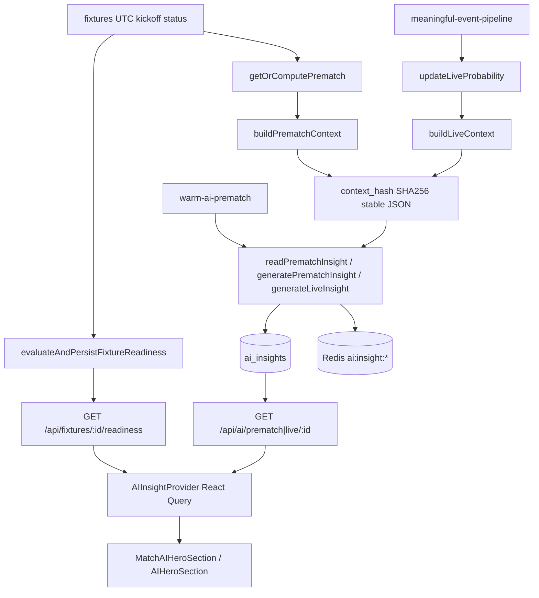

# Audit 06-1 — AI eligibility, context, context_hash, identical-insight

**Date:** 2026-10-10  
**Prerequisites:** [03-2-readiness-model.md](./03-2-readiness-model.md), [04-1-prematch-prediction.md](./04-1-prematch-prediction.md), [02-2-features-ai-context.md](./02-2-features-ai-context.md)  
**Note:** `docs/audit/05-2-*.md` was not present in the repo; live snapshot binding follows live prediction rows (`predictions.id`, `LiveFeatureVector.asOf` + core stats).

---

## 1. Root causes (pre-change)

| ID    | Issue                                                                                                                                                 | Impact                                                                                                  |
| ----- | ----------------------------------------------------------------------------------------------------------------------------------------------------- | ------------------------------------------------------------------------------------------------------- |
| AI-01 | Empty `catch` when computing prematch context hash ([aiService.ts](../lib/services/aiService.ts), [persist.ts](../lib/fixtures/readiness/persist.ts)) | Stale historical insights served; `aiGenerationAllowed` could stay true without a known hash            |
| AI-02 | Live `context_hash` omitted `predictionId` and live snapshot identity                                                                                 | Distinct live probability rows could share one cached live narrative                                    |
| AI-03 | No assertion that prediction/snapshot `fixtureExternalId` matches requested fixture in context build                                                  | Wrong prediction object paired with fixture id could produce misleading context                         |
| AI-04 | Display win probabilities always from model via [merge-insight.ts](../lib/ai/merge-insight.ts)                                                        | Many matches show **similar percentages** when models are generic or weak — not necessarily a cache bug |
| AI-05 | RC-6 stale prematch read ([readPrematchInsight](../lib/services/aiService.ts))                                                                        | Old narrative shown with `contextStale` until regen — intentional, not cross-fixture                    |
| AI-06 | Odds not in AI context schema                                                                                                                         | Cannot ground LLM on odds; readiness marks `odds` unavailable                                           |

---

## 2. Lifecycle (production flow)

**Belgrade timezone:** lifecycle windows for readiness (72h / 36h) use Europe/Belgrade via readiness constants; kickoff storage remains UTC.

---

## 3. Eligibility

### Prematch generation (`gates.aiGenerationAllowed`)

Requires NS/TBD, within 72h compute window, not post-kickoff, fresh prediction fingerprint, sufficient features/history, within 36h LLM window, **computed `currentContextHash` present**, no hash compute failure, and (no insight or insight hash ≠ current hash).

`generatePrematchInsight` also enforces `canGeneratePrematchNarrative`, `isAiContextReady`, and readiness for active prematch mode.

### Blocked

- `NEITHER` phase, insufficient signal, readiness failure, historical stored insight with stale/unknown hash, paused live for live gen, guest on authenticated AI routes (403).

### Guests vs signed-in

| Surface              | Guest                                        | Signed-in                                                                    |
| -------------------- | -------------------------------------------- | ---------------------------------------------------------------------------- |
| Prematch AI GET/POST | 403                                          | Allowed                                                                      |
| Live AI GET          | 403                                          | Allowed                                                                      |
| Match hero           | `guest` state; live delta probabilities only | Full narrative + auto-ensure                                                 |
| Prematch daily quota | N/A (API blocked)                            | Prematch narrative **not** gated by personal quota (shared cache)            |
| Live quota           | Pipeline gen has no `userId`                 | `live_match` / `live_interval` when `userId` passed to `generateLiveInsight` |

### Live vs prematch AI

- **Prematch:** PIT `buildFixtureHistoryFeatures`, `analyticsCompact`, shared rows per `(fixture, PREMATCH, context_hash)`.
- **Live:** Event/periodic pipeline, non-PIT form/H2H, append-only live rows per hash; hash now tied to live prediction row identity.

---

## 4. AI context coverage

| Data                                     | Prematch               | Live                                        |
| ---------------------------------------- | ---------------------- | ------------------------------------------- |
| Teams, league, venue, referee, round     | Yes                    | Yes                                         |
| Standings, form, H2H, historical compact | PIT + analyticsCompact | Last-5 non-PIT (02-2 gap)                   |
| Lineups, sidelined                       | Yes                    | Yes                                         |
| Model prediction / xG markets            | Yes                    | Yes                                         |
| Live score, minute, stats, triggers      | —                      | Yes                                         |
| Prematch reference                       | —                      | Official/latest prematch + optional summary |
| Odds                                     | **Unavailable**        | **Unavailable**                             |

Missing data is listed in `dataMissing`; not fabricated as zeros in prematch history paths. Live feature vector still coerces missing scores to 0 for the **model** ([live-features.ts](../lib/models/live-features.ts)) — unchanged; called out as remaining limitation.

---

## 5. context_hash (after change)

Central module: [lib/ai/context-hash-input.ts](../lib/ai/context-hash-input.ts).

### Prematch hash inputs

`fixtureExternalId`, model/prompt versions, kickoff/status, league, team external ids, prediction block, form, h2h, standings, lineups, sidelined, dataAvailable/dataMissing, `analyticsCompact`, referee, round, `historicalContext`, `predictionFeatures`. Excludes `dataTimestamp` and team names (names remain in LLM JSON only).

### Live hash inputs

Prematch live fields **plus** `predictionId` and `liveSnapshotId` (`computeLiveSnapshotIdentity` over `LiveFeatureVector`: `asOf`, minute, score, xG, red cards, anchor probs). Excludes volatile prompt-only fields like `dataTimestamp`.

### Identity guards

- `assertPrematchPredictionMatchesFixture` — prediction + snapshot fixture id.
- `assertLivePredictionMatchesFixture` — prediction + live snapshot fixture id.

Throws `AiContextIdentityError` before context assembly.

---

## 6. Identical-insight analysis

**Not a single cache key bug:** Redis keys include `fixtureExternalId` and `context_hash`. DB reads scope by fixture UUID.

**Contributing factors:**

1. Model-driven UI probabilities (AI-04).
2. Thin or generic contexts producing similar LLM outputs.
3. AI-01 allowing stale narrative without hash validation (fixed).
4. AI-02 live cache collision across probability rows (fixed).

**RC-6:** Prematch read may return latest insight with `contextStale: true` while regen runs — provider watches readiness and POSTs when allowed.

---

## 7. Changes made

| Area                       | Files                                                                                                                     |
| -------------------------- | ------------------------------------------------------------------------------------------------------------------------- |
| Hash + identity            | `lib/ai/context-hash-input.ts`, `lib/services/aiContextService.ts`                                                        |
| Historical hash resolution | `lib/services/aiService.ts` (`PrematchContextHashResolution`, Sentry on failure)                                          |
| Readiness                  | `lib/fixtures/readiness/evaluate.ts`, `lib/fixtures/readiness/persist.ts` (`contextHashComputeFailed`)                    |
| Tests                      | `lib/ai/context-identity.test.ts`, `lib/fixtures/readiness/readiness.test.ts`, `lib/services/aiService.readiness.test.ts` |

**Database:** no migration.

---

## 8. Tests

| Scenario                                      | File                                       |
| --------------------------------------------- | ------------------------------------------ |
| Fixture-specific prematch hashes              | `lib/ai/context-identity.test.ts`          |
| Wrong fixture id rejected                     | `lib/ai/context-identity.test.ts`          |
| Live predictionId / snapshot id changes hash  | `lib/ai/context-identity.test.ts`          |
| Meaningful live stat vs noise                 | `lib/ai/context-identity.test.ts`          |
| Hash compute failure → UNAVAILABLE historical | `lib/services/aiService.readiness.test.ts` |
| Readiness blocks gen on hash compute failure  | `lib/fixtures/readiness/readiness.test.ts` |
| FR-04 stale hash                              | `lib/services/aiService.readiness.test.ts` |
| Lineups change hash                           | `lib/ai/cache.test.ts` (existing)          |

---

## 9. Verification

| Command                 | Result (2026-10-10)                  |
| ----------------------- | ------------------------------------ |
| `npm.cmd run test:ci`   | **795 passed** (188 files)           |
| `npm.cmd run typecheck` | Passed                               |
| `npm.cmd run lint`      | 0 errors, 13 warnings (pre-existing) |

---

## 10. Remaining limitations

- Live AI context form/H2H not PIT (02-2).
- Odds not ingested into AI context.
- Live score coercion to 0 in live feature vector for modeling.
- Similar win bars across fixtures when predictions are generic baseline.
- `docs/audit/05-2-*.md` not available; live binding uses prediction row id + snapshot identity hash.

---

## 11. Assumptions

1. Live snapshot identity = `predictionId` + hashed `LiveFeatureVector` core fields (no separate snapshot column).
2. Odds remain out of scope until product ingests and types them for AI.
3. Identical **percentages** across fixtures are acceptable when model outputs differ; tests assert hash/context **identity**, not LLM wording.
4. Requiring non-null `currentContextHash` for `aiGenerationAllowed` is correct because persist always attempts hash when prediction + features exist.
