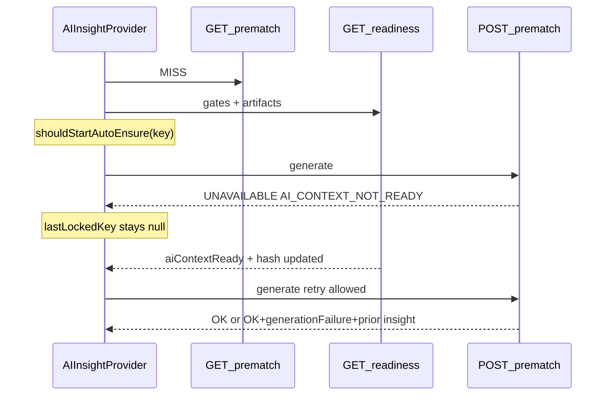
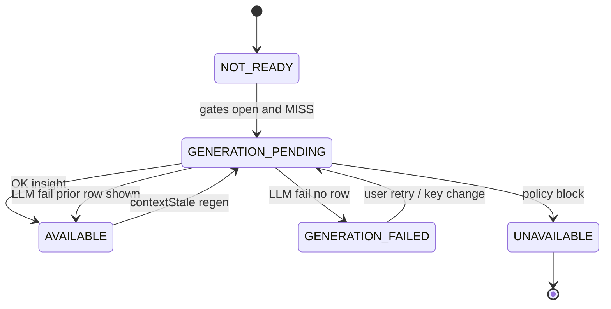

# Audit 06-2 — AI states, race, generation failures

**Date:** 2026-10-11  
**Prerequisites:** [06-1-ai-context.md](./06-1-ai-context.md), [03-2-readiness-model.md](./03-2-readiness-model.md)

---

## 1. Root causes (pre-change)

| ID    | Issue                                                                               | Impact                                                      |
| ----- | ----------------------------------------------------------------------------------- | ----------------------------------------------------------- |
| ST-01 | `ensureAttemptedRef` set **before** POST completed; stayed true after `UNAVAILABLE` | Auto-ensure never retried when context became ready (T0–T5) |
| ST-02 | Attempt key ignored prediction fingerprint / context hash / `aiContextReady`        | Same mount blocked regen after readiness caught up          |
| ST-03 | `generatePrematchInsight` catch returned `FALLBACK` (prediction only)               | Valid stored narrative hidden on LLM failure                |
| ST-04 | Historical read returned `UNAVAILABLE` on stale hash                                | Post-match UI showed “no analysis” despite DB row           |
| ST-05 | Client synthesized `FALLBACK` on HTTP errors                                        | Generic failure UI without refetching stored insight        |
| ST-06 | Fragmented API / hook / readiness states                                            | Inconsistent “generating” vs blocked vs failed              |
| ST-07 | Generic failure copy could stand in for fixture narrative                           | Risk of non-specific text when insight missing              |

---

## 2. Lifecycle (after change)

**Belgrade timezone:** unchanged — readiness LLM windows and display copy use Europe/Belgrade; timestamps UTC in storage.

---

## 3. Canonical state model

Module: [`lib/ai/canonical-insight-state.ts`](../lib/ai/canonical-insight-state.ts)

| State                | Meaning                                                                             |
| -------------------- | ----------------------------------------------------------------------------------- |
| `NOT_READY`          | Loading or context/readiness not sufficient                                         |
| `UNAVAILABLE`        | Fixture/policy block (`FIXTURE_NOT_ANALYZABLE`, guest, limit, etc.)                 |
| `GENERATION_PENDING` | Eligible cache miss or stale regen in flight                                        |
| `GENERATION_FAILED`  | Generation attempted for current hash and failed; no narrative to show              |
| `AVAILABLE`          | Stored narrative shown (may be `contextStale` or carry `generationFailure` overlay) |

**Reason codes** include: `AI_CONTEXT_NOT_READY`, `READINESS_NOT_MET`, `STALE_CONTEXT_HASH`, `OPENAI_TIMEOUT`, `OPENAI_PROVIDER_ERROR`, `MALFORMED_OUTPUT`, `RATE_LIMIT`, `DAILY_LIMIT`, `GENERATION_CONCURRENT`, etc.

**Stale insight:** stored `context_hash` ≠ current hash; readiness `artifacts.aiPrematch.stale`; shown with `contextStale: true`.

**API transport:** existing discriminant preserved; added `GENERATION_FAILED`, optional `generationFailure` on `OK`, richer `UNAVAILABLE.reason` (`AI_CONTEXT_NOT_READY`, `READINESS_NOT_MET`). Legacy `FALLBACK` still mapped in canonical resolver.

---

## 4. Changes made

| Area                    | Files                                                                                                                                                                                                           |
| ----------------------- | --------------------------------------------------------------------------------------------------------------------------------------------------------------------------------------------------------------- |
| Auto-ensure keying      | `lib/ai/prematch-auto-ensure.ts`, `components/ai/AIInsightProvider.tsx`                                                                                                                                         |
| Canonical states        | `lib/ai/canonical-insight-state.ts`, `lib/ai/schemas.ts`, `lib/ai/prematch-insight-state.ts`                                                                                                                    |
| Generation failures     | `lib/ai/generation-failure.ts`, `lib/services/aiService.ts`                                                                                                                                                     |
| Generic narrative guard | `lib/ai/narrative-fixture-specificity.ts`                                                                                                                                                                       |
| Cron                    | `lib/ingestion/warm-ai-prematch.ts` (`GENERATION_FAILED` counted like fallback)                                                                                                                                 |
| Tests                   | `prematch-auto-ensure.test.ts`, `canonical-insight-state.test.ts`, `generation-failure.test.ts`, `narrative-fixture-specificity.test.ts`, `aiService.generation.test.ts`, updated `aiService.readiness.test.ts` |

**Database:** no migration.

---

## 5. Tests

| Scenario                                    | File                                                         |
| ------------------------------------------- | ------------------------------------------------------------ |
| T0–T5 context after load                    | `lib/ai/prematch-auto-ensure.test.ts`                        |
| AI context unavailable                      | `lib/services/aiService.generation.test.ts`                  |
| Generation success (existing paths)         | `lib/services/aiService.test.ts`                             |
| Failure + prior insight preserved           | `lib/services/aiService.generation.test.ts`                  |
| Timeout / provider / malformed / concurrent | `generation-failure.test.ts`, `aiService.generation.test.ts` |
| Stale historical insight                    | `aiService.readiness.test.ts`                                |
| Generic fallback blocked                    | `narrative-fixture-specificity.test.ts`                      |
| Canonical mapping                           | `canonical-insight-state.test.ts`                            |
| Wrong fixture ID                            | `lib/ai/context-identity.test.ts` (unchanged)                |

Prematch POST is not gated by personal daily quota (shared cache per 06-1); `DAILY_LIMIT` mapping tested via `classifyGenerationFailure` for live/quota paths.

---

## 6. Verification

| Command                 | Result (2026-10-11)                  |
| ----------------------- | ------------------------------------ |
| `npm.cmd run test:ci`   | **815 passed** (193 files)           |
| `npm.cmd run typecheck` | Passed                               |
| `npm.cmd run lint`      | 0 errors, 13 warnings (pre-existing) |

---

## 7. Remaining limitations

- Live-phase canonical states not fully unified (prematch-focused).
- Prematch user POST still not daily-quota gated (by design).
- Odds absent from AI context (06-1).
- `FALLBACK` status retained for backward compatibility; new failures prefer `GENERATION_FAILED` or `OK` + `generationFailure`.

---

## 8. Assumptions

1. Readiness API returns full `FixtureReadinessSnapshot` including `artifacts.prediction.fingerprint` and `artifacts.aiPrematch.contextHash` when persisted.
2. Auto-ensure locking outcomes: `OK`, `GENERATION_FAILED`, `FALLBACK`, `AI_LIMIT_REACHED` only.
3. Fixture-specific narrative guard applies when `modelTier !== GENERIC_BASELINE` and requires a team name token in summary or commentary.
4. Historical stale insight should be shown (RC-6 parity) rather than `UNAVAILABLE` when a row exists.
