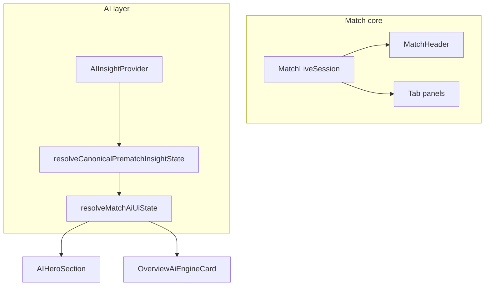

# Audit 08-1 — Match page state architecture

**Date:** 2026-10-11  
**Prerequisites:** [06-2-ai-states.md](./06-2-ai-states.md), [07-1-live-ai.md](./07-1-live-ai.md), [05-1-live-state.md](./05-1-live-state.md)

---

## 1. Current state architecture

### Layering

| Layer                | Responsibility                                | Key modules                                            |
| -------------------- | --------------------------------------------- | ------------------------------------------------------ |
| Fixture / match core | Score, status, minute, events, stats, lineups | `MatchLiveSession`, `useLiveMatch`, tab panels         |
| Fixture lifecycle    | Upcoming → live → finished; Belgrade windows  | `lib/fixtures/readiness/lifecycle.ts`                  |
| AI transport         | GET/POST insight, readiness gates             | `AIInsightProvider`, React Query                       |
| Canonical (backend)  | `NOT_READY` … `AVAILABLE`                     | `lib/ai/canonical-insight-state.ts`                    |
| **UI (new)**         | `AI_READY` … `NO_DATA`                        | `lib/ai/match-ai-ui-state.ts` → `aiUiState` on context |

Core match UI does not wait on AI: `MatchLiveSession` wraps header and tabs; `AIInsightProvider` wraps hero and overview AI surfaces only.

### Match / fixture states

| User-facing                                  | Code                                                                                            |
| -------------------------------------------- | ----------------------------------------------------------------------------------------------- |
| Upcoming / imminent / collecting             | Readiness `phase`, `PREMATCH_SCHEDULED_LEAD_MS`, `IMMINENT_BEFORE_KICKOFF_MS` (Europe/Belgrade) |
| Starting (kickoff passed, status still `NS`) | Provider lag edge case                                                                          |
| Live / HT / ET / pens                        | `LIVE_FIXTURE_STATUSES`                                                                         |
| Paused                                       | `INT`, `SUSP`                                                                                   |
| Finished                                     | `FT`, `AET`, `PEN`                                                                              |
| Postponed / cancelled / abandoned            | `NEITHER_FIXTURE_STATUSES`                                                                      |
| Missing fixture                              | Redirect from match page                                                                        |
| Partial data                                 | Readiness items + panel empty states                                                            |

### Canonical → UI mapping

| Canonical (06-2)                 | UI state                                                |
| -------------------------------- | ------------------------------------------------------- |
| `AVAILABLE`                      | `AI_READY`                                              |
| `GENERATION_PENDING`             | `AI_LOADING`                                            |
| `NOT_READY` (loading)            | `AI_LOADING`                                            |
| `NOT_READY` (context/readiness)  | `AI_NOT_READY` (or `AI_LOADING` if model already shown) |
| `UNAVAILABLE`                    | `AI_UNAVAILABLE`                                        |
| `GENERATION_FAILED` (no insight) | `AI_FAILED`                                             |
| No insight, no prediction, idle  | `NO_DATA`                                               |

Live phase uses the same `resolveMatchAiUiState` with live insight status, hook transport state, and delta flags — live “model only, waiting for narrative” maps to **`AI_LOADING`**, not `AI_FAILED`.

---

## 2. UX / state problems (pre-change)

| ID    | Issue                                | Status                                                               |
| ----- | ------------------------------------ | -------------------------------------------------------------------- |
| MP-01 | Canonical states not in UI           | **Fixed** — wired via provider                                       |
| MP-02 | Generic “no analysis”                | **Improved** — `describeMatchAiUiState` + reason-specific copy       |
| MP-03 | Live model-only vs failure conflated | **Fixed** — live `fallback` → `AI_LOADING`                           |
| MP-04 | Raw live unavailable codes           | **Fixed** — `formatLivePredictionUnavailableReason`                  |
| MP-05 | Prematch object used for live probs  | **Fixed** — `LiveModelProbabilitiesBlock`                            |
| MP-06 | Generation failure overlay weak      | **Fixed** — hero card badges + message                               |
| MP-07 | Duplicate delta fetch                | **Mitigated** — overview prefers `liveDelta` from provider when live |

---

## 3. Changes

| Area             | Files                                                                                                                                                 |
| ---------------- | ----------------------------------------------------------------------------------------------------------------------------------------------------- |
| UI state model   | [`lib/ai/match-ai-ui-state.ts`](../lib/ai/match-ai-ui-state.ts)                                                                                       |
| Provider wiring  | [`components/ai/AIInsightProvider.tsx`](../components/ai/AIInsightProvider.tsx) — `aiUiState`, `aiUiCopy`, `liveDelta`, canonical prematch resolution |
| Live copy        | [`lib/ai/live-insight-state.ts`](../lib/ai/live-insight-state.ts) — plain-language live unavailable                                                   |
| Hero             | [`components/ai/AIHeroSection.tsx`](../components/ai/AIHeroSection.tsx), [`AIHeroCard.tsx`](../components/ai/AIHeroCard.tsx)                          |
| Overview AI card | [`components/match/OverviewAiEngineCard.tsx`](../components/match/OverviewAiEngineCard.tsx)                                                           |

**Database:** no migration.

---

## 4. Tests

| Scenario                                                           | File                                                                                                           |
| ------------------------------------------------------------------ | -------------------------------------------------------------------------------------------------------------- |
| Canonical → UI mapping, live unavailable copy                      | [`lib/ai/match-ai-ui-state.test.ts`](../lib/ai/match-ai-ui-state.test.ts)                                      |
| Live progressive partial + plain unavailable message               | [`lib/ai/live-insight-state.test.ts`](../lib/ai/live-insight-state.test.ts)                                    |
| Hero: loading, postponed, ready, failure overlay, live model block | [`components/ai/AIHeroSection.test.tsx`](../components/ai/AIHeroSection.test.tsx)                              |
| Existing match overview regression                                 | [`MatchOverviewLiveClient.test.tsx`](../components/match/MatchOverviewLiveClient.test.tsx) (unchanged, passes) |

---

## 5. Remaining UX edge cases

- Post-FT live GET still returns `NOT_LIVE`; last live narrative only via stored rows / historical paths (07-1).
- Kickoff reached while status remains `NS` — header may show scheduled label until provider sync.
- `INT` / `SUSP`: live AI generation blocked; match core may still update.
- `predictionStale`: narrative can lag newest LIVE row while delta shows fresh probabilities (by design).
- Finished fixtures: delta still fetched from overview query when not in live provider phase.
- Guest live: `AI_UNAVAILABLE` with model numbers + locked card (unchanged product rule).

---

## 6. Verification

| Command                 | Result (2026-10-11)                  |
| ----------------------- | ------------------------------------ |
| `npm.cmd run test:ci`   | **855 passed** (200 files)           |
| `npm.cmd run typecheck` | Passed                               |
| `npm.cmd run lint`      | 0 errors, 13 warnings (pre-existing) |

---

## 7. Assumptions

1. Prematch canonical resolver from 06-2 remains authoritative for pre-live phases; live UI state derives from the same `resolveMatchAiUiState` entry point with live-specific inputs.
2. `PrematchInsightHookState` remains the transport layer for API responses; UI components prefer `aiUiState` for user-facing copy.
3. Showing prior narrative with `generationFailure` or `contextStale` is still **`AI_READY`**, not `AI_FAILED`.
4. Europe/Belgrade lifecycle display policy unchanged; timestamps stored UTC.
5. Overview card may still query delta for finished matches when provider `liveDelta` is undefined (non-live fixture phase in provider).
